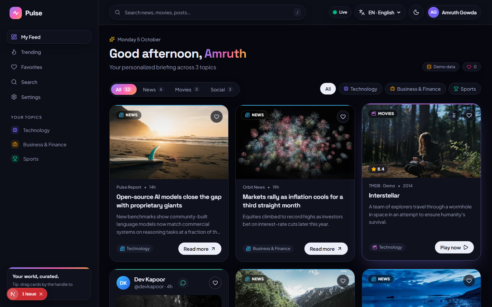
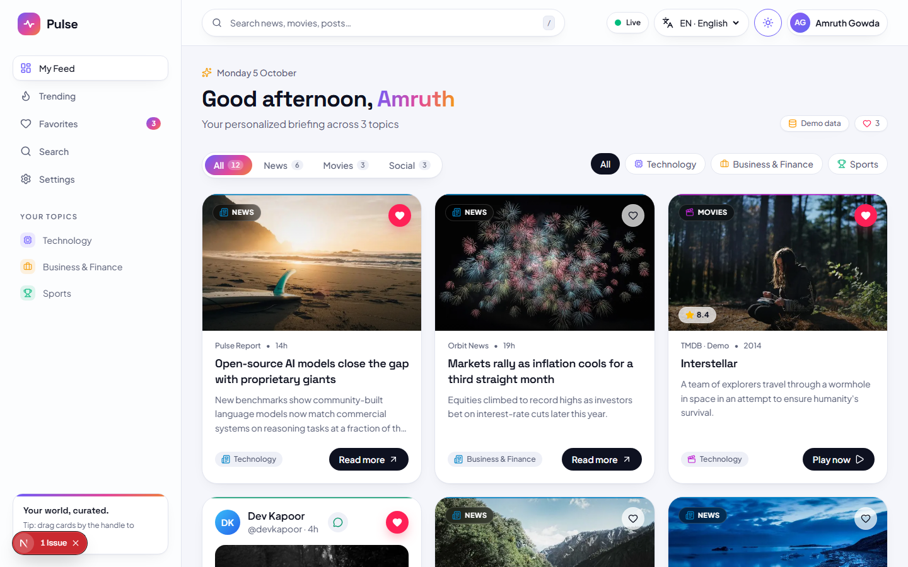
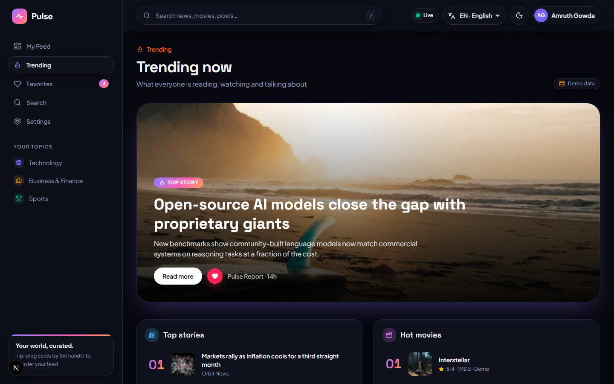
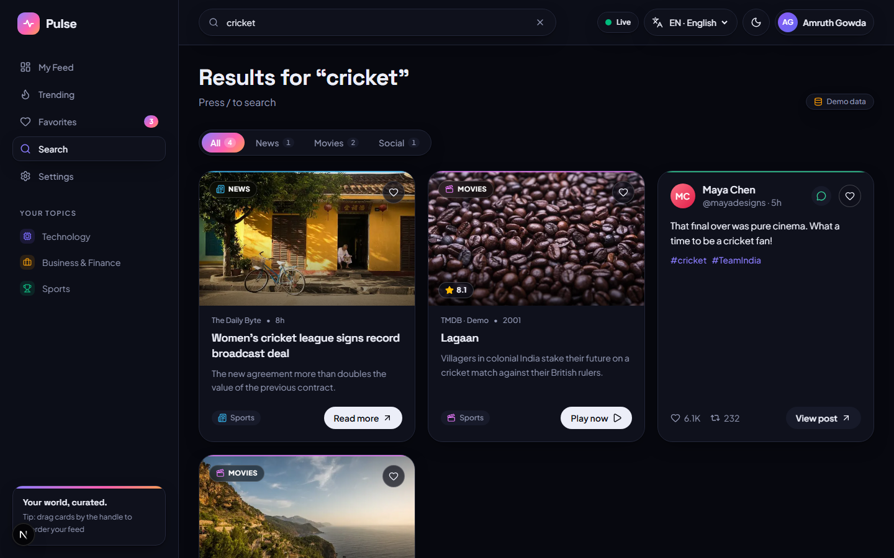
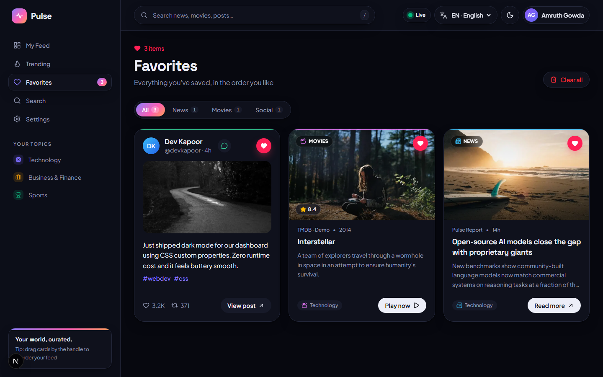
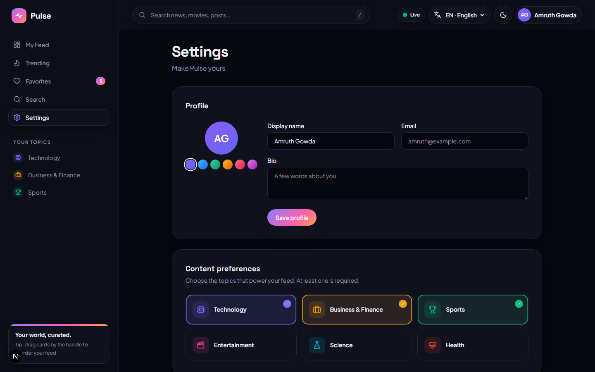
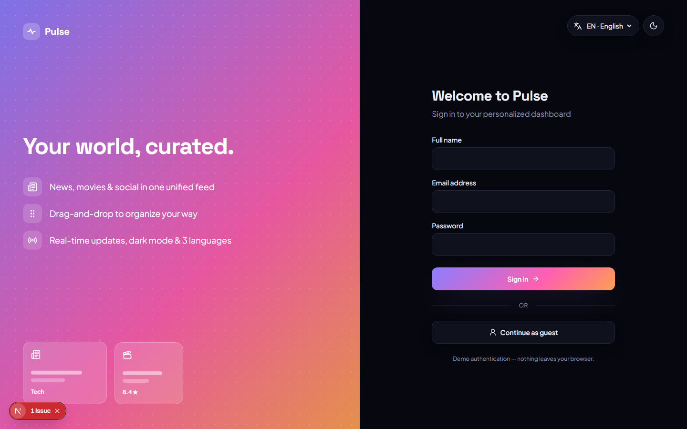
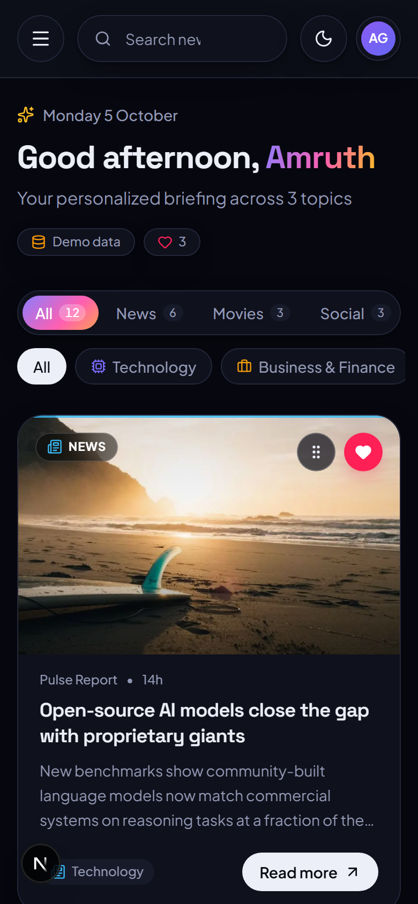
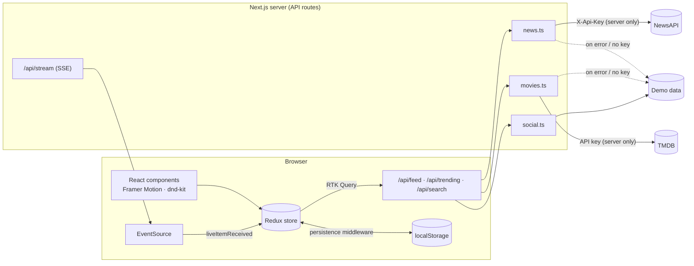

<div align="center">

# ⚡ Pulse: Personalized Content Dashboard

**News, movies and social posts in one beautiful, customizable feed.**

Built with **Next.js 16 · React 19 · TypeScript · Redux Toolkit (RTK Query) · Tailwind CSS v4 · Framer Motion · dnd-kit · Jest · Playwright**

[Live demo](#) · [Demo video](#) · [Next.js notes for React devs](./NEXTJS_FOR_REACT_DEVS.md)



</div>

---

## ✨ Highlights

- **One unified feed** that mixes **NewsAPI** articles, **TMDB** movie recommendations and **social posts** (mock API) based on your chosen topics.
- **Infinite scrolling.** Pages load as you scroll, with skeleton placeholders and a keyboard-accessible "Load more" fallback.
- **Drag-and-drop reordering** of feed cards and favorites with mouse, touch **and keyboard** (Space → Arrows → Space).
- **Debounced global search** across all content types. Press <kbd>/</kbd> anywhere to search. Results get shareable URLs (`/search?q=…`).
- **Trending section** with a hero top story and ranked lists for news, movies and posts.
- **Favorites** are saved to localStorage, reorderable, and filterable by type.
- **Real-time updates** via **Server-Sent Events**: new posts stream in and appear behind a "↑ 3 new posts" pill.
- **Dark / light / system theme** built on CSS custom properties, with no flash on reload.
- **3 languages** (English, हिन्दी, Español) via react-i18next.
- **Mock authentication** with login, guest mode, protected routes and an editable profile (name, bio, avatar colour).
- **Works without API keys.** Built-in demo data kicks in automatically, and a badge shows whether you're seeing *live* or *demo* data.

## 📸 Screenshots

| Light mode | Trending |
|---|---|
|  |  |
| **Search** | **Favorites (drag to reorder)** |
|  |  |
| **Settings** | **Login** |
|  |  |

<p align="center"></p>

---

## ✅ Requirements checklist

| Requirement | Implementation |
|---|---|
| User preferences (categories) | Settings → *Content preferences*; stored in Redux + localStorage. Changing topics refetches the feed. |
| News API | `src/lib/server/news.ts`: NewsAPI top-headlines per category, `everything` for search |
| Recommendations API | `src/lib/server/movies.ts`: TMDB discover (genres mapped from your topics), trending and search |
| Social API | `src/lib/server/social.ts`: mock API filtered by hashtags (brief allows a mock) |
| Interactive cards | Image, headline, description, source, time, **Read more / Play now / View post** CTA, favorite button, preview dialog |
| Infinite scroll / pagination | RTK Query `infiniteQuery` + `IntersectionObserver` (`useInfiniteScroll`) + "Load more" button |
| Responsive layout | Sticky glass header (search, live status, language, theme, account) + sidebar (drawer on mobile) |
| Feed / Trending / Favorites sections | `/`, `/trending`, `/favorites` |
| Search + debounce | `useDebounce` (400 ms) → RTK Query; only the settled value is fetched |
| Drag-and-drop | `@dnd-kit/sortable`, with pointer, touch and keyboard sensors plus screen-reader announcements |
| Dark mode | CSS custom properties + Tailwind `dark:` variant, persisted, no-flash inline script |
| Animations | Framer Motion page transitions, staggered card entrances, shared-layout tab indicator, heart burst, skeleton shimmer, hover lift |
| Redux Toolkit | 5 slices (`preferences`, `favorites`, `feed`, `auth`, `ui`) + RTK Query API slice |
| Async logic | RTK Query (caching, de-duplication, loading/error states, infinite pages) |
| Persistence | Custom SSR-safe persistence middleware (whitelisted + debounced + validated) |
| Unit tests | Slices, persistence, hooks, pure logic, server sources & API routes |
| Integration tests | Feed / Search / Settings / Login rendered with a real store: loading, empty, error, filters, live posts |
| E2E tests | Playwright: **search**, **drag-and-drop**, **authentication**, preferences (desktop + mobile) |
| ⭐ Bonus: Auth | Mock auth with protected routes, `?next=` redirect (open-redirect safe), guest mode, profile editing |
| ⭐ Bonus: Real-time | Server-Sent Events at `/api/stream` with auto-reconnect |
| ⭐ Bonus: i18n | react-i18next: English, Hindi, Spanish (pluralization included) |

---

## 🚀 Getting started

**Requirements:** Node.js 20+ and npm.

```bash
git clone <your-repo-url> pulse-dashboard
cd pulse-dashboard
npm install
cp .env.example .env.local   # optional: add API keys for live data
npm run dev
```

Open **http://localhost:3000**, then sign in with any name/email (password ≥ 6 chars) or click **Continue as guest**.

### API keys (optional)

The app works fully without keys using realistic demo data. For live content, add free keys to `.env.local`:

| Variable | Where to get it |
|---|---|
| `NEWS_API_KEY` | https://newsapi.org/register |
| `TMDB_API_KEY` *or* `TMDB_READ_TOKEN` | https://www.themoviedb.org/settings/api |

> Keys are used **only on the server** inside Next.js API routes and are never shipped to the browser. If an upstream API fails or hits its rate limit, that source falls back to demo data so the UI never breaks.

### Scripts

| Command | Description |
|---|---|
| `npm run dev` | Start the dev server |
| `npm run build && npm start` | Production build & serve |
| `npm run lint` / `npm run typecheck` | ESLint / TypeScript |
| `npm test` | Unit + integration tests (Jest + React Testing Library) |
| `npm run test:coverage` | Tests with coverage report |
| `npm run test:e2e` | Playwright E2E (run `npx playwright install chromium` once first) |

---

## 🧭 User flow

1. **Sign in** (or continue as guest) → redirected back to the page you originally requested.
2. **My Feed** greets you by name and shows a mixed feed for your topics. Filter by type (News / Movies / Social) or topic, scroll for more, ♥ to save, drag cards by the handle to reorder.
3. A **"↑ new posts"** pill appears as real-time posts arrive. Click it to add them to the top.
4. **Trending** shows the top story plus ranked news, movies and posts.
5. **Search**: start typing in the header (or press <kbd>/</kbd>). Results update once you pause typing.
6. **Favorites** lists everything you saved, in your own drag-and-drop order, and survives reloads.
7. **Settings** lets you edit your profile, topics, theme, language and live updates, or reset all data.

---

## 🏗️ Architecture



**Backend-for-frontend:** the browser makes **one request per feed page**. The server fetches all three sources **in parallel**, normalizes them into a single `ContentItem` type, interleaves them (2 news : 1 movie : 1 post) and returns the page. Upstream responses are cached with Next.js `fetch` revalidation (10 min for news, 1 h for movies) to protect free-tier quotas.

### Project structure

```
src/
├── app/                      # Next.js App Router (file-based routing)
│   ├── (dashboard)/          # Route group: shared sidebar/header layout
│   │   ├── page.tsx          #   /           → Feed
│   │   ├── trending/         #   /trending
│   │   ├── favorites/        #   /favorites
│   │   ├── search/           #   /search
│   │   └── settings/         #   /settings
│   ├── login/                # /login
│   └── api/                  # Server endpoints: feed, trending, search, stream (SSE)
├── components/
│   ├── cards/                # ContentCard, FavoriteButton, PreviewModal, skeletons
│   ├── feed/                 # ContentGrid (async states), SortableGrid (dnd-kit)
│   ├── layout/               # AppShell, Sidebar, Header, SearchBar, theme/lang/user controls
│   ├── views/                # Page-level client components
│   └── ui/                   # Avatar, Logo, SegmentedTabs, SmartImage, StateViews, Spinner
├── hooks/                    # useDebounce, useInfiniteScroll, useLiveFeed, useHydrated
├── i18n/                     # react-i18next setup + en / hi / es (type-checked against en)
├── lib/
│   ├── server/               # NewsAPI, TMDB & social sources (server only)
│   ├── mock/                 # Deterministic demo data
│   └── feed.ts               # Pure helpers: interleave, dedupe, applyOrder, reorderSubset…
└── store/                    # Redux Toolkit: slices, RTK Query API, persistence middleware
e2e/                          # Playwright specs
```

---

## 🧠 Key decisions

- **RTK Query `infiniteQuery`** handles pagination, caching and loading/error flags without hand-written thunks. Changing topics changes the cache key, so a fresh feed is fetched automatically.
- **dnd-kit instead of React DnD**, because it supports **keyboard and touch** dragging with built-in screen-reader announcements, which matters for WCAG. Dragging uses a dedicated handle so clicks on links and buttons still work. Reordering inside a *filtered* view writes back into the right slots (`reorderSubset`).
- **Custom persistence middleware instead of redux-persist:** a ~60-line, SSR-safe middleware that saves only `preferences`, `favorites` and `auth`, debounces writes, and never writes before hydration (which would overwrite saved data). Each slice validates persisted data on load.
- **Hydration safety:** the server renders a splash screen and the client hydrates persisted state afterwards. `useHydrated` (built on `useSyncExternalStore`) guarantees the first client render matches the server HTML, and an inline script applies the saved theme before first paint.
- **Store per tab:** the Redux store is created inside a client provider (never as a module singleton), which is the recommended App Router pattern.

## 🔒 Security

- API keys live only in server env vars and are sent as **headers** (not in URLs). The browser only talks to our own `/api/*` routes.
- Input validation: categories are whitelisted, page numbers clamped, and search queries length-limited (400 on invalid input).
- External links use `rel="noopener noreferrer"`. The login redirect only accepts same-origin relative paths (blocks `//evil.com`).
- No passwords are stored. Security headers are set: `X-Content-Type-Options`, `X-Frame-Options`, `Referrer-Policy`, `Permissions-Policy`.

## ♿ Accessibility

Semantic landmarks, a skip-to-content link, `aria-current` navigation, `aria-pressed` toggles, labelled icon buttons, accessible dialogs (Escape to close, focus restore), `aria-live` for new posts and search results, visible focus rings, keyboard drag-and-drop, and full support for `prefers-reduced-motion`.

## ⚡ Performance

Debounced search · infinite pagination · server-side parallel fetching + caching · request de-duplication (RTK Query) · `next/image` lazy loading and optimization · self-hosted fonts via `next/font` · memoized cards · debounced localStorage writes · static prerendering of every page shell.

## 🧪 Testing

- **91 unit + integration tests** (Jest + React Testing Library), covering:
  - reducers, persistence edge cases (corrupted JSON, pre-hydration writes), and debounce timing
  - API normalization, fallback-on-failure, and API key handling
  - every async UI state (loading, empty, error, retry, load more, live posts)
  - login validation and Settings interactions
- **16 E2E tests** (Playwright, desktop + mobile), covering:
  - search: verifies **one API request for 7 keystrokes**
  - mouse **and** keyboard drag-and-drop, plus favorites order persisting across reloads
  - auth redirect → sign in → reload → sign out
  - theme persistence, language switching, and topic changes
  - the preview dialog opens centred, stays still, and closes
- **CI:** GitHub Actions runs lint, type-check, tests with coverage, and E2E on every push.

## ☁️ Deployment (Vercel, free)

1. Push to GitHub → import the repo at [vercel.com/new](https://vercel.com/new).
2. Optionally add `NEWS_API_KEY` / `TMDB_API_KEY` under *Environment Variables*.
3. Deploy. Vercel detects Next.js automatically.

> NewsAPI's free plan is meant for development, so on a deployed site the app may show demo news. TMDB works in production on the free plan.

---

<div align="center">Made with ❤️ using Next.js</div>
